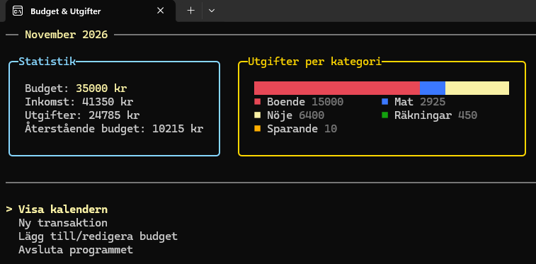
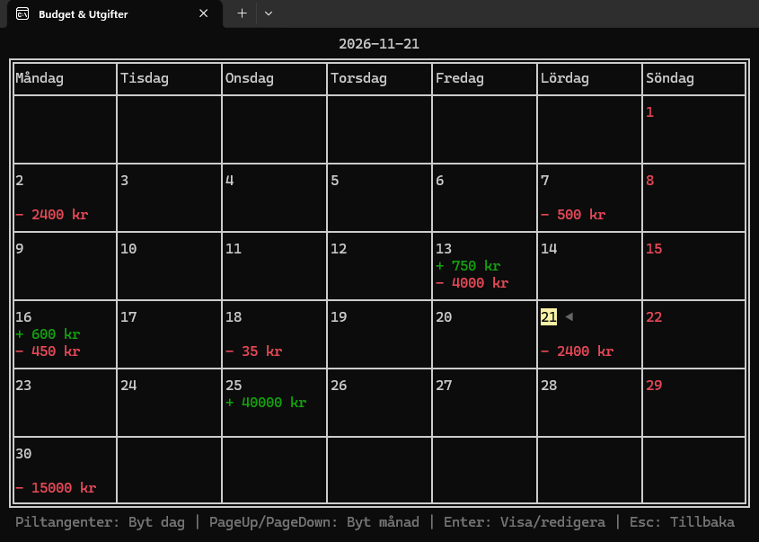

# Ship It – Budget

En terminalapplikation för personlig budgethantering, byggd i C# med Spectre.Console
Utvecklad av gruppen **Ship It** (Carl Svensson, Firat Caan och Peter Omnéus) i kursen *Objektorienterad programmering, grund* – inlämningsuppgiften DataVerse Manager.



## Funktioner

* **Kalender:** bläddra mellan dagar och månader med piltangenterna och se dagens inkomster och utgifter.
* **Transaktioner:** lägg till, redigera och radera inkomster och utgifter per dag.
* **Månadsbudget:** sätt en utgiftsgräns och se hur mycket som återstår.
* **Statistik:** summor för månaden och ett diagram över utgifter per kategori.
* **Logg:** alla ändringar och fel sparas i `log.json`.



## Kom igång

**Krav:** .NET 10 SDK och en terminal med stöd för Unicode.

```bash
git clone https://github.com/peteromneus-education/ship-it-budget.git
cd ship-it-budget
dotnet run --project ShipItBudget
```

Eller öppna `ShipItBudget/ShipItBudget.csproj` i Visual Studio och tryck F5.

**Navigering:** piltangenter och Enter i menyerna, Esc för att gå tillbaka eller avbryta.

## Datalagring

All data sparas som JSON i mappen `Storage` bredvid programfilen, t.ex. `ShipItBudget/bin/Debug/net10.0/Storage/`:

| Fil | Innehåll | Sparas |
| --- | --- | --- |
| `transactions.json` | Transaktioner | När programmet avslutas |
| `budgets.json` | Månadsbudgetar | När programmet avslutas |
| `log.json` | Händelser och fel | Direkt när CRUD-operationerna utförs |

Kan en datafil inte läsas så avslutas programmet utan att filen skrivs över. Kan den inte sparas får användaren välja att gå tillbaka till menyn.

## Design

* **Models / Services / UI:** modellerna beskriver data, `BudgetService` innehåller reglerna och UI-klasserna sköter bara in- och utmatning.
* **Generisk lagring:** `DataStore<T>` (AddItem, RemoveItem, FindItem, LoadFromJson, SaveToJson) och `JsonFileStorage` används för både transaktioner, budgetar och loggposter.
* **Komposition i stället för arv:** objekten skapas i `Program.cs` och skickas in via konstruktorer. Arv behövdes inte i lösningen.
* **Validering i flera lager:** formulären validerar inmatningen, och modellerna kontrollerar igen så att ogiltiga objekt aldrig skapas.

## Kända begränsningar

* Data sparas först vid avslut. Stängs fönstret med X försvinner ändringarna, trots att loggen visar dem (#55).

## Kravuppfyllelse

### Grundkrav (G)

- [x] **Objektorienterad lösning med generiska klasser och metoder:** `DataStore<T>`, `JsonFileStorage.Save<T>`/`Load<T>` och `TryLoad<T>`/`TrySave<T>` i `Program.cs`.
- [x] **Startmeny med färg, pilval och animerad startskärm:** `WelcomeScreen` (FigletText och animerad spinner) och `MainMenu` (SelectionPrompt med färgmarkering).
- [x] **CRUD:** transaktioner skapas, visas, redigeras och raderas via `DayMenu` och `TransactionForm`; månadsbudgetar skapas och uppdateras via `BudgetForm`.
- [x] **Data i tabeller:** månadskalendern i `CalendarView` och dagens transaktioner i `DayMenu`.
- [x] **JSON: laddas vid start och sparas vid avslut** – `Program.cs`, `DataStore<T>` och `JsonFileStorage`.
- [x] **Generisk klass för datalagring:** `DataStore<T>` med `AddItem`, `RemoveItem`, `FindItem`, `SaveToJson` och `LoadFromJson`.
- [x] **try/catch i kritiska metoder:** `LoadFromJson` och `SaveToJson` fångar fil- och JSON-fel med undantagsfilter.
- [x] **Tydliga färgade felmeddelanden:** fel datatyp och ogiltiga värden (t.ex. belopp ≤ 0) avvisas direkt i prompten; en oläslig datafil ger ett rött meddelande med filens sökväg. En saknad fil behandlas som första start.
- [x] **Spectre.Console:** `Table`, `Panel`, `BreakdownChart`, `FigletText`, spinner och färgkodad markup.
- [x] **LINQ för sökning, filtrering och sortering:** `FirstOrDefault`, `Any`, `Where`, `OrderBy`, `GroupBy` och `Sum` i `BudgetService`.

### GitHub och dokumentation

- [x] **Brancher och pull requests:** allt arbete sker i feature-brancher som slås ihop via granskade PR:er.
- [x] **Branch protection:** regeluppsättning (ruleset) på `main`.
- [x] **README** med beskrivning, skärmbilder och körinstruktioner.
- [x] **Designval och OOP:** se avsnittet *Design*.

### Kodstruktur

- [x] `Program.cs` som startpunkt, samt mapparna `Models/`, `Services/` och `UI/`.
- [x] Kommentarer i koden och enhetlig namngivning.

### VG-tillägg (minst två av fyra)

- [x] **Loggning av fel och händelser till `log.json`:** `Logger`, `LogEntry`, `LogLevel` och `LogEvent`.
- [x] **Statistik:** summor för månaden, återstående budget och utgifter per kategori på huvudmenyn.
- [ ] Undo/redo med Stack – inte implementerat.
- [ ] Animationer och progress bars vid laddning – startskärmen är animerad, men ingen progress bar visas vid laddning.
